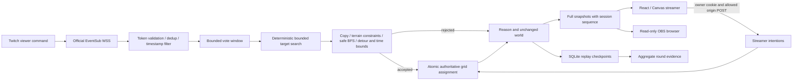

# CrowdForge architecture

## Authority and data flow

`apps/server/main.py` owns sessions and the asyncio event loop. Game methods are synchronous with no awaits inside a mutation, so there is no concurrent writer between validation and the grid assignment. This is an in-process atomicity guarantee, not a distributed transaction. Run one worker and one replica. Async OAuth/network operations are outside mutation transactions.

## Integrity policy

`world.py::Mutation` allows only lava/wall/bridge with integer coordinates and 1–12 targets. Validation copies the grid, rejects duplicate targets, protects boundaries/player/exit, enforces terrain transformations and the one-tile new-lava buffer, then searches only ground/bridge cells. Rules 2 additionally limit shortest-safe-route growth to 12 steps and require the resulting route's `steps × 0.2s + 0.5s` estimate to fit the round time left. The estimate assumes five successful moves/second plus a small reaction reserve; it does not model network latency or guarantee a human win.

Before/after route steps and counts of lava-adjacent safe route tiles are reported. The route never requires lava traversal. Adjacency is a descriptive exposure proxy, not mandatory HP loss. Policies can reject support proposals late in a doomed run; a rejection does not repair an already bad situation caused by the player's actions. Emergency rescue is separately labeled.

On acceptance, `Game.mutate` commits once and appends deterministic versions, protocol phases, target tile diffs and metrics. On rejection, grid/version are unchanged; rejection count and explanatory audit/feed change. The entire proposal rolls back if any target fails. Target search remains bounded at 240 candidates. Runtime validation timing is measured separately from the deterministic audit to avoid injecting clock noise into replay hashes.

## Inputs, clocks, replay and snapshots

The server ticker advances a fixed .1s step after each sleep; under overload simulation time can drift behind wall time. Vote timestamps map Twitch UTC delivery to the current round clock. Messages older than the latest start/resume/freeze/mode boundary do not count. This is a practical single-process game clock, not hard real-time scheduling.

Replay records control/move/tick/explicit-mutation/mode-window-reset operations. Tick records store aggregate winner/count, avoiding chatter identities. Rules version 2 hashes grid, player, health, time, phase, stats, world version, freeze flag, movement cooldown, vote-window metadata/counts and audit. Legacy records without a rules field use rules 1 to retain earlier semantics. The proof endpoint reconstructs only a paused/finished owner's round and compares both digest and audit. It is consistency evidence, not cryptographic attestation against a dishonest server or an externally signed log.

World version describes game transitions; it resets on a new round and does not increment for a rejected mutation or a vote receipt. `Session.snapshot_sequence` instead increases across all emitted HTTP/WebSocket snapshots and resets only with a new session. React uses that shared sequence to prevent late POST replies from rolling back a newer socket snapshot, including across round reset. Full snapshots are the reconnect recovery mechanism. There is no client-side prediction: 90ms animation interpolates only already acknowledged adjacent movement; authority remains server-side.

## Trust boundaries

Owner cookie: HttpOnly, SameSite=Lax, Secure when PUBLIC_URL is HTTPS. Mutation POSTs and sockets require exact allowed origins. OAuth state expires after ten minutes, is single-use and binds to both owner and OAuth cookies. Tokens live only in server memory. Observer tokens authorize viewing, never controls, replay export or proof verification. Query secrets are redacted from Uvicorn logs; reverse-proxy logging remains operator configuration.

The Twitch adapter uses `user:read:chat`, `channel.chat.message` v1, expiry refresh and hourly validation. Server-directed handoff inherits subscriptions and overlaps old/new readers; loss requires a fresh subscription. Client periodic pings are disabled; the library still handles server ping/pong replies. Twitch does not replay outage messages. [Transport contract](https://dev.twitch.tv/docs/eventsub/handling-websocket-events/); [token-validation contract](https://dev.twitch.tv/docs/authentication/validate-tokens/).

Diagnostics expose aggregate counters and timestamps, not message bodies, chatter IDs or OAuth credentials. Receipt/delivery counts are transport observations; accepted game inputs include replacement votes and are not unique-viewer counts. The simulation path remains explicitly labeled.

## Persistence, deployment and operational limits

SQLite stores replay evidence on mutations, pause, termination/reset and graceful shutdown. Checkpoint failures become visible diagnostics and are caught so the ticker can continue. In-memory replay export is still available if disk fails. Active sessions, cookies' target sessions and Twitch tokens do not restore after process restart. Synchronous writes and proof reconstruction can block this single event loop; no high-load isolation is claimed.

Resource caps: 100 sessions/process, five per owner cookie, eight sockets/session, 20 action requests/sec with burst 20, 20k distinct vote message IDs/window, 50k transport dedup IDs/65 seconds, bounded socket queues. Anonymous users can create new cookies, so edge request limits are required for untrusted public traffic. Owner command history can grow during repeated paused controls; public use needs broader abuse/retention controls. These are limits, not load-test results.

Docker builds the Vite frontend into the non-root Python image, binds through Compose to loopback and mounts a named SQLite volume. A persistent HTTPS/WSS reverse proxy is required for a public installation. GitHub Actions tests unit/browser/replay/benchmark paths and separately builds Compose, restarts it and verifies saved evidence. New evaluation commands are also included in CI.
